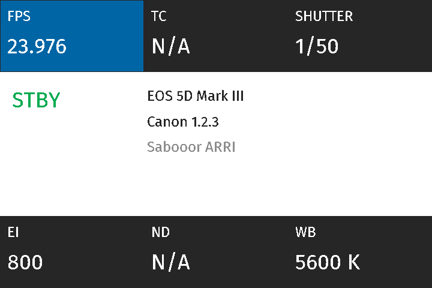

# Sabooor ARRI — comunidade Canon / Magic Lantern

Port do visual Sabooor ARRI para modelos Canon com Magic Lantern, começando pela **EOS 5D Mark III**. O nome do repositório foi preservado; a arquitetura usa perfis explícitos para receber outros modelos depois de revisão.

**Estado: versão experimental de desenvolvimento. 5D3 1.1.3 e 1.2.3 compiladas no computador; teste físico pendente. Outros modelos ainda não recebem suporte por apenas existirem na árvore upstream.**

## Implementado na 5D Mark III

- Menu inspirado no mapa ALEXA 35, HOME, navegação e acesso ao menu original por INFO.
- Monitor com moldura preta, REC/STBY, exposição, espaço do cartão ativo e identificação full frame.
- Guias 16:9, 2,35:1, 1:1 e 9:16; controles nativos disponíveis ligados pelo nome original do ML.
- Look com emulações Fuji Provia, Velvia e Superia para prévia LCD, intensidade e integração anamórfica, condicionado ao formato de buffer suportado.
- Fontes de monitor derivadas de FiraGO sob SIL OFL: nenhuma fonte DIN proprietária é distribuída.

## Diferença importante da 600D

Na 5D3, Recording Resolution e Project Rate abrem o menu Canon, onde se escolhem resolução, cadência e ALL-I/IPB. O mod **não** reutiliza os setters e tamanhos de propriedades da 600D. O upstream alerta para cabeçalhos de vídeo corrompidos ao alternar certos modos em LiveView na DIGIC V. Zoom LCD usa o controle nativo com bloqueio durante REC.

O Look não altera H.264 e não aplica LUT ao HDMI. Sua velocidade e estabilidade reais na 5D3 ainda precisam de teste. RAW/MLV continua a cargo dos módulos originais; esta entrega não valida todas as combinações de módulos.

## Código completo e compilação

O patch versionado contém o código e recursos do mod. O preparador baixa a base GPL exata descrita em `upstream.json` e aplica o patch com verificação de integridade, reconstruindo a árvore completa.

```sh
python3 prepare.py source
export ARM_BINPATH=/caminho/arm-gnu-toolchain/bin
sh source/tools/build-sabooor-community.sh 5D3.113 -j4
# ou, separadamente, para firmware Canon 1.2.3:
sh source/tools/build-sabooor-community.sh 5D3.123 -j4
```

Dependências: Git, Make, compilador C do computador, Python 3 e toolchain ARM bare-metal. A validação local usou Arm GNU 13.2.Rel1. Pillow é necessário para os testes de renderização e para gerar as fontes; instalar com `python3 -m pip install Pillow` em ambiente virtual. Leia `docs/VALIDACAO.md` e `docs/INSTALACAO.md` antes de preparar um cartão.

## Testes no computador

```sh
cd source
SABOOOR_TEST_PLATFORM=5D3.113 python3 tests/sabooor/test_camera_controls.py
SABOOOR_TEST_PLATFORM=5D3.113 python3 tests/sabooor/test_runtime.py
SABOOOR_TEST_PLATFORM=5D3.113 python3 tests/sabooor/test_exact_map.py ../render-5d3
```

Repita para 5D3.123. Os mesmos testes aceitam 600D.102 para regressão. São testes do código C com entradas de câmera simuladas; não emulam o hardware Canon.

Consulte `docs/MODELOS.json`, `docs/ROADMAP.md` e `docs/PORTABILIDADE.md`. Código sob GPL-2.0-or-later, fontes FiraGO sob SIL OFL e gerador de emulações sob MIT, com avisos incluídos no patch. Projeto independente, sem afiliação à Canon, ARRI ou Fujifilm.

## Pacotes experimentais

[5D3 firmware 1.1.3](dist/sabooor-arri-5D3.113-experimental.zip) · [5D3 firmware 1.2.3](dist/sabooor-arri-5D3.123-experimental.zip) · [SHA256](dist/SHA256SUMS.txt). Usar somente com Magic Lantern já funcional no firmware exato, após ler as instruções. Não são builds estáveis validados em câmera.


